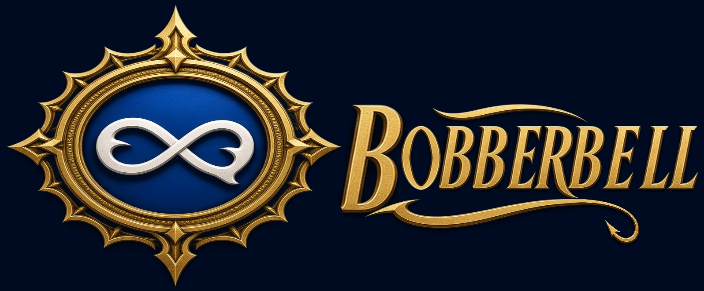
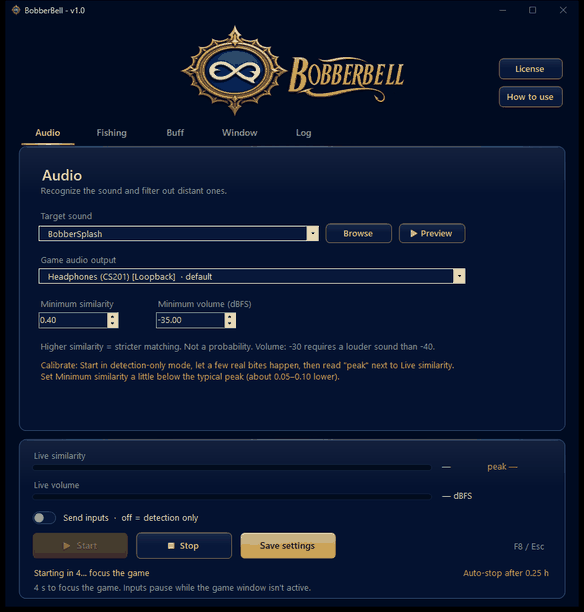
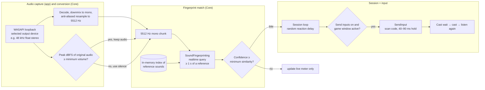
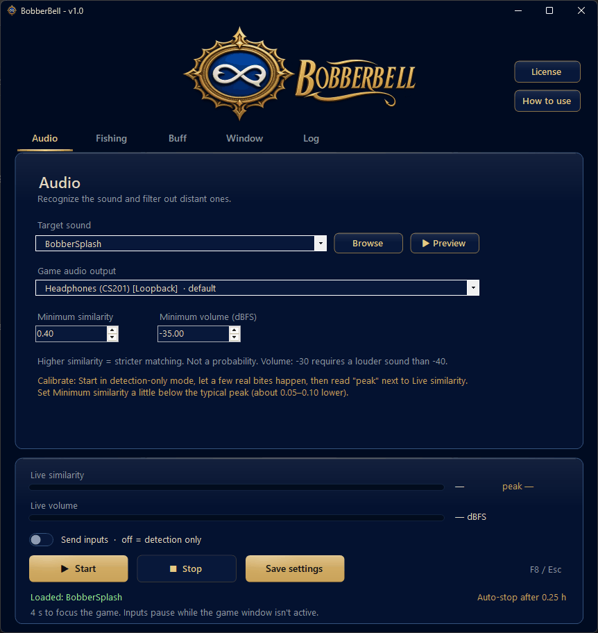
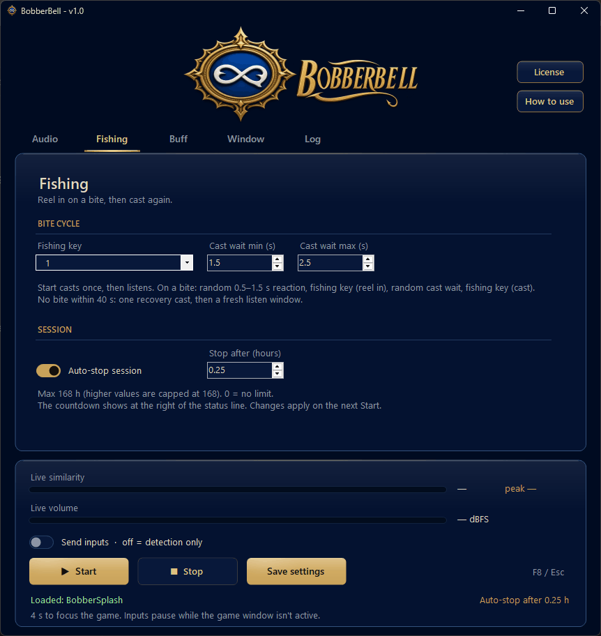
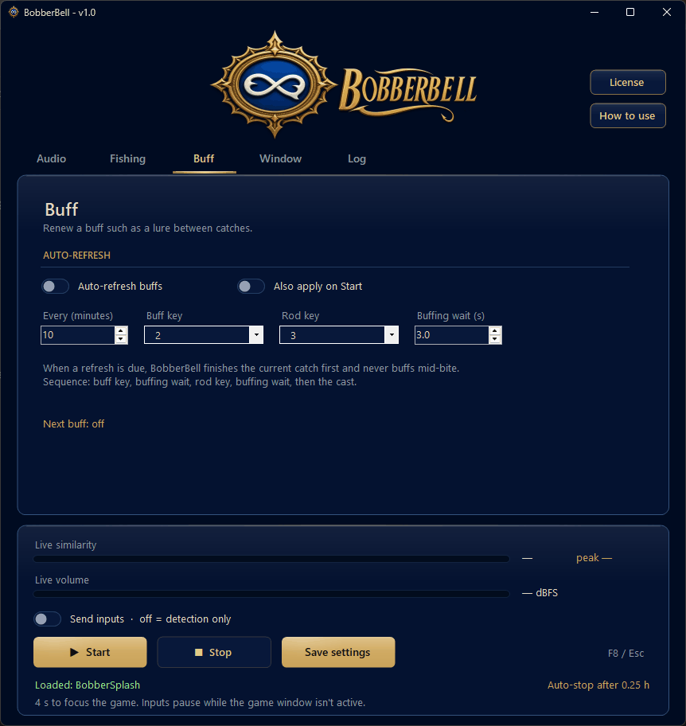
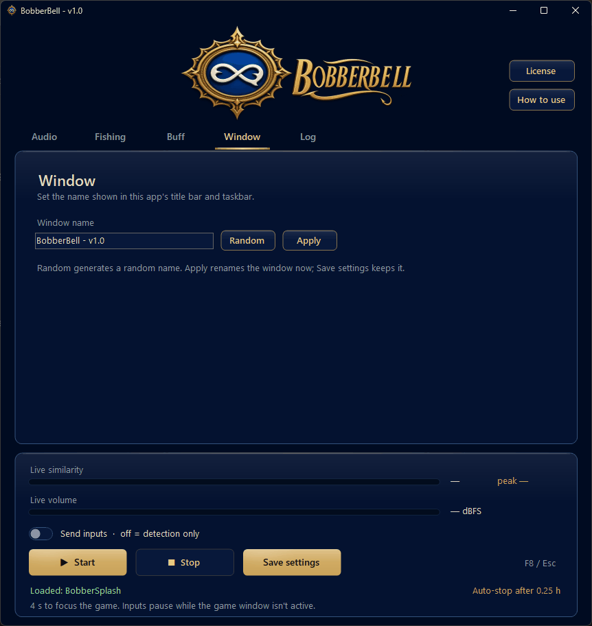
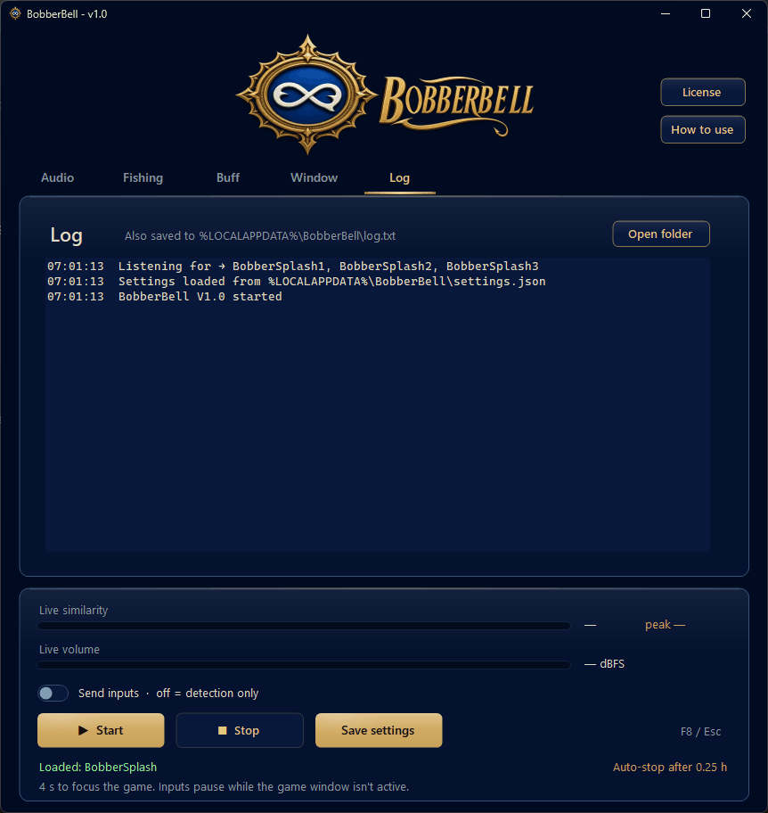

<p align="center">
  
</p>

<h1 align="center">BobberBell</h1>

<p align="center"><b>Audio-triggered input automation for Windows.</b><br>
Listens for a specific sound, then pushes a specified button, hands-free.</p>

<p align="center">
  <a href="https://github.com/Moosecat313/BobberBell/actions/workflows/ci.yml"></a>
  <a href="https://github.com/Moosecat313/BobberBell/actions/workflows/codeql.yml"></a>
</p>

<p align="center">
  <a href="https://github.com/Moosecat313/BobberBell/releases/tag/v1.0.2">Download v1.0.2</a> ·
  <a href="#architecture">Architecture</a> ·
  <a href="#security">Security</a> ·
  <a href="#how-to-use">How to use</a> ·
  <a href="CHANGELOG.md">Changelog</a>
</p>

BobberBell is a small Windows desktop app (C# / WinForms, .NET 10). It listens to an audio output device (WASAPI loopback),
recognises a reference sound with audio fingerprinting, and answers with a key press or mouse click. The pipeline is generic:
any short, distinctive sound can trigger any allow-listed key.

**Flagship example: World of Warcraft fishing.** BobberBell hears the bobber splash, presses the fishing key to reel in, and
casts again, with randomized timing, a session time limit and timed buffs.

<p align="center"></p>
<p align="center"><sub>Starting a session in detection-only mode: 4-second focus countdown, then listening with the auto-stop timer running.</sub></p>

## Contents
- [Features](#features)
- [Architecture](#architecture)
- [Design decisions](#design-decisions)
- [Security](#security)
- [Screenshots](#screenshots)
- [Requirements](#requirements)
- [Install](#install)
- [How to use](#how-to-use)
- [Settings and log files](#settings-and-log-files)
- [Build, test and package](#build-test-and-package)
- [FAQ / Troubleshooting](#faq--troubleshooting)
- [Disclaimer](#disclaimer)
- [License](#license)

## Features
- **Sound detection:** audio fingerprinting with a minimum-similarity threshold and a minimum-volume filter, plus live similarity and volume meters with a "peak" readout for calibration.
- **Built-in sounds:** **BobberSplash** loads three bobber-splash recordings, and any of them counts as a bite. You can also use your own recording (WAV, MP3, FLAC or OGG), and Preview plays the selected sound.
- **Bite cycle:** a random 0.5–1.5 s reaction, then the fishing key reels in. After a random cast wait (default 1.5–2.5 s) it casts again. If nothing bites within 40 s, it makes a recovery cast.
- **Auto-stop session:** on by default and set to 0.25 h. The maximum is 168 h, and 0 means no limit, which shows a warning.
- **Buffs:** optional timed buff refresh (for example a lure) using a buff key and a rod key. It never buffs in the middle of a bite.
- **Default keys:** fishing **1**, buff **2**, rod **3**. Options include Space, Enter, Tab, Mouse 4/5, 0–9, - and =, A–Z, F1–F12, Left Ctrl, Left Shift and the arrows.
- **Safety:** Send inputs is always off at launch, so you can test in detection-only mode. Inputs pause when the game window isn't active. **F8** starts or stops and **Esc** stops, from anywhere.
- **Window name:** custom or random window title.
- **Log:** the Log tab lists bites, casts, buffs and errors, and also writes them to a log file.
- **Look:** a navy and gold interface with a subtle glass/metallic finish.
- **Licensing:** license-gated, with the license bound to the PC (offline; codes are stored only as salted PBKDF2 hashes). Each PC gets a 5-minute trial of total running time first.

## Architecture


The solution is split so that everything that can be tested without Windows, audio hardware or a UI is:

| Project | Target | Contents |
|---|---|---|
| `src/BobberBell.Core` | `net10.0` (any OS) | Detection engine (`SplashFingerprintEngine`, `ListenSession`: capture-format decoding, mono downmix, streaming 5512 Hz resampler, realtime fingerprint query with restart); settings model, validator and JSON store; license service and trial service; session timer and buff schedule; detection thresholds; key allow-list; sound-file path validator; redacting file logger. |
| `src/BobberBell` | `net10.0-windows` | WinForms UI (`UI/MainForm.*.cs` partials, `UI/Controls/*`), Windows services behind interfaces (`IAudioDetector` → `LoopbackFingerprintDetector`, `IInputSender` → `WindowsInputSender`, `IMachineIdProvider` → `RegistryMachineIdProvider`, `GlobalHotkeyHook`), and all P/Invoke in `Interop/NativeMethods.cs`. |
| `tests/BobberBell.Tests` | `net10.0` | xUnit v3 tests for Core, including audio conversion and an end-to-end detection run of each bundled splash through simulated 48 kHz stereo loopback. |
| `tools/BobberBell.DetectionHarness` | `net10.0-windows` | Console tool: plays each splash (and non-splash controls) through a real output device while the Core engine listens on that device's loopback, and prints the confidence per file. |

## Design decisions
- **Fingerprinting, not waveform matching.** Spectral fingerprints tolerate volume changes, mixing with other game audio and slight pitch/timing drift. A cheap per-chunk loudness gate runs first; quiet chunks reach the matcher as silence, so they cannot match but the stream's timeline keeps moving.
- **Convert at the edge.** The loopback device's native format (rate, channels, float or PCM) is converted once, in Core, to the 5512 Hz mono stream the fingerprinter requires, using a stateful band-limited resampler so chunk boundaries are seamless and nothing above the new Nyquist aliases into the band the fingerprints use. Reference files go through the same 5512 Hz mono decode.
- **Loopback, not microphone.** Capturing the output device hears exactly what the game renders, without room noise or a mic permission.
- **Safe by default.** *Send inputs* is never persisted and is off at every launch; the app only sends keys while the window that had focus at the end of the countdown is still active; the session auto-stops after 0.25 h by default, and settings files cannot raise it above 168 h or silently disable it.
- **Allow-listed inputs.** Every bindable key comes from one catalog (`KeyCatalog`); settings that name anything else fall back to the defaults.
- **Monotonic time.** Session and buff deadlines use `Environment.TickCount64`, so changing the clock can't extend or end a session.
- **One logger.** All activity goes through `IAppLogger`, which redacts user-profile paths before anything is written or shown. Message boxes are reserved for things the user must act on.
- **Pure core, thin UI.** Logic that decides anything (clamping, thresholds, timing, licensing) lives in `BobberBell.Core` and is unit-tested on Linux and Windows; the WinForms layer only moves values between controls and services.
- **Behaviour-preserving refactor.** The portfolio refactor kept every user-visible string, default and layout; screenshots of every tab before and after are pixel-identical inside the window (apart from log timestamps).

## Security
A short summary; details are in [SECURITY.md](SECURITY.md) and the STRIDE threat model in [docs/THREAT_MODEL.md](docs/THREAT_MODEL.md).

- **Untrusted inputs are validated:** `settings.json` is size-capped (64 KB), parsed with a strict source-generated contract (no comments, trailing commas, duplicate keys or string-typed numbers; max depth 8) and every value is clamped or allow-listed. Sound files must be WAV/MP3/FLAC/OGG, at most 50 MB, local (no UNC paths, which could leak NTLM credentials, no device paths or alternate data streams), and library sounds must resolve inside the app's `Sounds` folder.
- **Licensing:** codes never appear in the binary or on disk, only salted PBKDF2-SHA256 hashes (200,000 iterations); comparisons are constant-time (`CryptographicOperations.FixedTimeEquals`); `license.dat` is bound to the PC with HMAC-SHA256 over the Windows MachineGuid and is never written unbound.
- **Trial:** used seconds are signed with HMAC-SHA256 under a key derived from the MachineGuid, kept in a file and a registry mirror (the larger valid copy wins), counted with a monotonic clock and never decrease; edited or copied records end the trial. It is a client-side deterrent, documented as resettable by a determined user (see the threat model).
- **Privacy:** audio is processed in memory only; nothing is recorded, uploaded or sent over the network (the app makes no network calls). Logs redact profile paths.
- **Native code hygiene:** all P/Invoke resolves from System32 only (DLL-planting defence); the keyboard hook is read-only and ignores injected keys.
- **Supply chain:** NuGet lock files with locked-mode restore in CI, NuGet audit plus a `dotnet list package --vulnerable` gate, Dependabot for NuGet and Actions, all Actions pinned to commit SHAs, least-privilege workflow tokens, gitleaks over the full git history, and CodeQL (`security-extended`).
- **Build hygiene:** nullable reference types, .NET analyzers at `latest` with all security rules, warnings as errors, deterministic builds (`PathMap`, `ContinuousIntegrationBuild`).

## Screenshots
| Audio | Fishing |
|---|---|
|  |  |
| **Buff** | **Window** |
|  |  |

<details><summary>Log tab</summary>


</details>

## Requirements
- Windows 10 or 11, **x64**
- The release zip (`BobberBell-1.0.2.zip`): the [**.NET 10 Desktop Runtime (x64)**](https://dotnet.microsoft.com/download/dotnet/10.0). Self-contained builds and the installer from CI need no runtime.
- A BobberBell license key (asked for on first launch), or use the 5-minute trial first

## Install
1. Download **BobberBell-1.0.2.zip** from the [v1.0.1 release](https://github.com/Moosecat313/BobberBell/releases/tag/v1.0.2).
2. Verify the download (optional but recommended). In PowerShell:
   ```powershell
   Get-FileHash .\BobberBell-1.0.2.zip -Algorithm SHA256
   ```
   It must match the SHA-256 listed for that file in the [release notes](https://github.com/Moosecat313/BobberBell/releases/tag/v1.0.2).
3. Unzip anywhere, for example `C:\Games\BobberBell`, and keep the `Assets` and `Sounds` folders next to `BobberBell.exe`.
4. Run `BobberBell.exe` and enter your license key, or choose **Start trial** to try it first (5 minutes of total running time per PC).

Builds from CI (`BobberBell-win-x64` artifact) contain the framework-dependent release zip, a self-contained single-file zip (no runtime needed), a per-user installer (no admin rights) and `SHA256SUMS.txt`.

## How to use
The same guide is built into the app (**How to use** button).

**1. Prepare the game.** Bind fishing to a single key (game keybinds or your addon). Buffs such as lures need a buff key and a rod key too.
- BobberBell only presses those keys. It never installs, reads or changes anything in the game.
- Keep the game's sound effects turned on.

**2. Target sound.** On the Audio tab, choose what BobberBell listens for.
- BobberSplash is the default. It loads BobberSplash1, BobberSplash2 and BobberSplash3, and any one of them counts as a bite.
- Custom file uses your own recording instead. Browse loads it (WAV, MP3, FLAC or OGG).
- The status line shows which sounds are loaded.
- Preview plays the sound once per press. With BobberSplash, each press plays the next splash. Preview is off while listening.
- *Tip: a short, clean clip of only the sound works best.*

**3. Audio output.** Select the speakers or headphones the game plays through (the `[Loopback]` entries).
- BobberBell hears everything on that output, not your microphone.
- The device is saved by name. If it's missing at startup, you get a warning and the default output is used.
- Keep the game volume steady and avoid music or videos on the same output.

**4. Minimum similarity.** How closely a sound must resemble the target. It is not a probability.
- The default is 0.40. Higher is stricter, and lower accepts more sounds.
- To calibrate, Start in detection-only mode, let a few real bites happen and read "peak" next to Live similarity. Set Minimum similarity a little below the typical peak (about 0.05 to 0.10 lower).
- If other sounds trigger it, raise it.

**5. Minimum volume.** Filters out quiet or distant sounds.
- The default is -35 dBFS. -30 needs a louder sound, and -40 accepts a quieter one.
- Both similarity and volume must pass for a match. Nearby players making the same sound can still match.

**6. Fishing.** On the Fishing tab, choose the fishing key and the cast wait.
- Start casts once, then listens. On a bite, it waits a random 0.5 to 1.5 s and reels in with the fishing key. After a random cast wait (default 1.5 to 2.5 s), the fishing key casts again.
- Each listen window lasts 40 s. If no bite is heard, it sends one recovery cast and starts a new window.
- F8 is reserved for Start and Stop.

**7. Session timer.** Auto-stop ends the session after a set time.
- Auto-stop is on by default, with **Stop after** set to 0.25 hours. The maximum is 168, and higher values are capped at 168.
- 0 means no limit and shows a one-time warning.
- The time left counts down at the right of the status line.

**8. Buffs.** On the Buff tab, renew a buff such as a lure on a timer.
- Turn on Auto-refresh and set the interval in minutes.
- When a refresh is due, BobberBell finishes the current catch first. It never buffs in the middle of a bite.
- The sequence is: buff key, buffing wait, rod key, buffing wait, then the cast.
- *Also apply on Start* buffs before the first cast.

**9. Start and stop.** Test first with **Send inputs** off (detection only), and watch the live bars and the Log.
- Send inputs is always off when BobberBell opens. Turn it on when you're ready to automate.
- After Start you have 4 s to click into the game. The window that's active when the countdown ends becomes the game window.
- F8 starts or stops and Esc stops, from anywhere, even inside the game.
- If you leave the game window, inputs pause (the status shows Paused) and resume when you return.

**10. Window name.** On the Window tab, set the name shown in the title bar and taskbar. Random makes a random name, Apply uses it now, and Save settings keeps it.

**11. Log and settings.** The Log tab lists bites, casts, buffs and errors. The Log confirms a key was sent, not that the game accepted it. **Save settings** stores your setup. Settings are not saved automatically on exit.

**12. License.** The License button shows the version and license status. The license is stored for your Windows user, tied to this PC, and checked at launch. Moving to a new PC means entering the code again. Without a license, each PC gets a 5-minute trial (total running time). During the trial, the License button or the gold line at the bottom asks for your key.

## Settings and log files
| What | Where |
|---|---|
| Settings (written by **Save settings**, loaded at launch) | `%LOCALAPPDATA%\BobberBell\settings.json` |
| Log | `%LOCALAPPDATA%\BobberBell\log.txt` (the Log tab's **Open folder** button opens it) |
| License | `%APPDATA%\BobberBell\license.dat` (bound to this PC) |
| Trial time used | `%LOCALAPPDATA%\BobberBell\trial.dat`, mirrored in `HKCU\Software\BobberBell` (signed, bound to this PC) |

To reset to defaults, close BobberBell and delete `settings.json`. Data from the pre-release name (WeatherBug) is migrated automatically on first launch.

## Build, test and package
Requires the **.NET 10 SDK or newer**. The app builds on Windows; Core and the tests also build and run on Linux and macOS.
```powershell
git clone https://github.com/Moosecat313/BobberBell.git
cd BobberBell
dotnet restore BobberBell.slnx --locked-mode
dotnet build BobberBell.slnx -c Release          # warnings are errors
dotnet test --solution BobberBell.slnx -c Release
# self-contained single-file exe (no .NET runtime needed) in artifacts\publish\win-x64\
dotnet publish src\BobberBell -c Release -p:PublishProfile=win-x64-singlefile
# optional installer (Inno Setup 6): artifacts\installer\BobberBell-1.0.1-setup.exe
iscc installer\BobberBell.iss
```
On Linux, add `-p:EnableWindowsTargeting=true` to build the Windows project. Releasing and the optional code-signing step are described in [docs/RELEASING.md](docs/RELEASING.md).

**CI** ([`ci.yml`](.github/workflows/ci.yml), `windows-latest`): gitleaks history scan, locked restore, Release build, tests, vulnerable-package gate, self-contained publish, Inno Setup installer, artifacts with SHA-256 sums. **CodeQL** ([`codeql.yml`](.github/workflows/codeql.yml)): C# `security-extended`, on every push and weekly.

Libraries: NAudio (Core, Wasapi, WinMM), SoundFingerprinting and SoundFingerprinting.Audio.NAudio, H.InputSimulator; xUnit v3 for tests.

## FAQ / Troubleshooting
**The app won't start or says .NET is missing.**
The release zip is framework-dependent: install the [.NET 10 Desktop Runtime (x64)](https://dotnet.microsoft.com/download/dotnet/10.0) (the plain .NET Runtime is not enough for a WinForms app). The self-contained build and installer from CI need no runtime.

**It asks for a license key every time, or says the key is invalid.**
Keys are at least 16 letters and numbers; dashes and spaces are ignored. The license is tied to your PC and Windows user, so a new PC or user needs the key again. If Windows' machine ID can't be read, the key works for that session only.

**The trial ended or isn't offered.**
The trial is 5 minutes of total running time per PC and doesn't reset. It isn't offered if the trial record was edited or copied from another PC, or if Windows' machine ID can't be read. Enter a license key to continue.

**It closes right away with "Please close … and start BobberBell again."**
A debugging or memory tool is running. Close it and start BobberBell again.

**Nothing is detected.**
Pick the right `[Loopback]` output on the Audio tab and make sure game sound effects are on. Watch Live similarity during a real bite, then set Minimum similarity a little below the peak. Lower Minimum volume (for example -40) if the splash is quiet.

**It triggers on other sounds.**
Raise Minimum similarity and/or Minimum volume. Avoid music or videos on the same output.

**Keys aren't reaching the game.**
Make sure **Send inputs** is on and that the game was the active window when the 4-second countdown ended. Inputs pause whenever the game window isn't active. The Log confirms a key was sent, not that the game accepted it.

**The session stopped by itself.**
That's Auto-stop (0.25 h by default). Change **Stop after** on the Fishing tab. 0 means no limit, which isn't recommended.

**My settings are gone after restarting.**
Settings are only saved when you press **Save settings**.

## Disclaimer
BobberBell automates keyboard and mouse input. Automating gameplay may violate the Terms of Service of World of Warcraft or other games and can lead to account penalties, including bans. **You use BobberBell entirely at your own risk.** The author accepts no liability for any consequences of its use. BobberBell is not affiliated with or endorsed by Blizzard Entertainment.

## License
Copyright © 2026 Chris Monoxide. **All rights reserved.** BobberBell is proprietary software and requires a license key. No permission is granted to copy, modify or redistribute this code or the binaries without the author's written consent.
