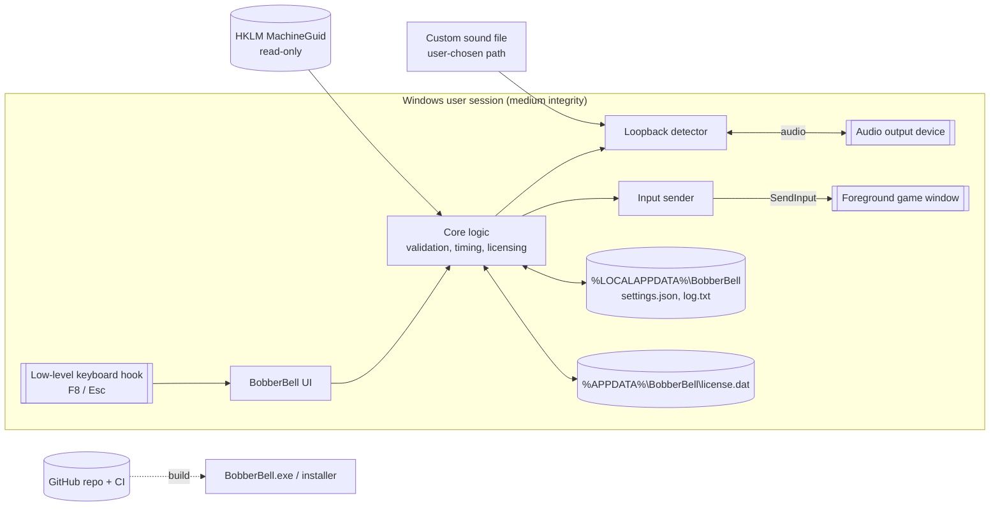

# BobberBell threat model

Method: STRIDE per element, for v1.0 as refactored on the `portfolio` branch. Reviewed 2026-11.

## 1. System overview
BobberBell is a single-user Windows desktop app. It captures the audio that an output device renders (WASAPI loopback),
fingerprints it, and when a reference sound is recognised it sends a key press with `SendInput`. It has no server component
and makes no network connections. It runs with the signed-in user's normal rights.

## 2. Assets
| Asset | Why it matters |
|---|---|
| A1. The user's PC and Windows account | The app runs as the user; a bug that runs code or leaks credentials affects everything they own. |
| A2. Keyboard/mouse input to other windows | Wrong or runaway input can act in the wrong window (chat, browser, terminal). |
| A3. Privacy: system audio and the Windows user name | Loopback hears everything the PC plays; log files are often shared when asking for help. |
| A4. License codes and license.dat | Unissued use; codes are shared among a small trusted group. |
| A5. Build pipeline and dependencies | A compromised dependency or workflow ships malware to every user. |

## 3. Trust boundaries
| # | Boundary | Data crossing it | Trust |
|---|---|---|---|
| TB1 | Files in the user profile → app | `settings.json`, `license.dat`, legacy WeatherBug files | **Untrusted**: any process running as the user, or a person with access to the profile, can edit them. |
| TB2 | User-chosen sound file → decoders | Path and file bytes (WAV/MP3/FLAC/OGG) | **Untrusted**: may come from the internet; decoders (NAudio, Media Foundation) parse complex formats. |
| TB3 | Audio device → detector | PCM samples from whatever is playing | **Untrusted**: any app or web page can play sound. |
| TB4 | App → other windows | `SendInput` keystrokes and XBUTTON clicks | Output boundary: must only reach the intended window. |
| TB5 | OS → app | MachineGuid (HKLM, read-only), foreground window, hook callbacks, DLL loading | Trusted OS, but DLL search order is attacker-influenced if the exe sits in a writable folder. |
| TB6 | Source repo / NuGet / GitHub Actions → shipped binary | Code, packages, workflow actions | Third-party supply chain. |

## 4. Threats and mitigations (STRIDE)
Status: **M** = mitigated, **P** = partially mitigated / accepted risk.

### Spoofing
| ID | Threat | Mitigation | Status |
|---|---|---|---|
| S1 | A license file copied from another PC is accepted. | `license.dat` holds `HMAC-SHA256(codeHash, "WeatherBug.License.v2|" + MachineGuid)`; the binding is checked with `FixedTimeEquals`. A missing MachineGuid means the key works for the session only and nothing is written. | M |
| S2 | Another window gets focus and receives the bot's keys (spoofed "game"). | The game window is captured once at the end of the countdown; every press checks `GetForegroundWindow() == gameWindow`, otherwise inputs pause. If BobberBell itself was active, no window is captured and inputs stay paused. | M |
| S3 | A sound played by another app or web page triggers a press. | Two gates (loudness and fingerprint similarity), detection-only mode for calibration, inputs only to the captured game window. A deliberately crafted replay of the reference sound will still match. | P |

### Tampering
| ID | Threat | Mitigation | Status |
|---|---|---|---|
| T1 | Edited `settings.json` disables the session limit, binds an arbitrary key, or injects huge/odd values. | 64 KB cap before reading; strict source-generated JSON contract (no comments, trailing commas, duplicate keys, string numbers; depth ≤ 8); `SettingsValidator` clamps every number to the UI range, caps hours at 168 (negative → 0.25), allow-lists keys and library entries, strips control characters, caps lengths. *Send inputs* is never read from disk. Unit-tested. | M |
| T2 | Edited `settings.json` points `LastSoundPath` at a UNC share (`\\attacker\x.wav`), which makes Windows send the user's NTLM hash, or at a device path / alternate data stream. | `SoundFileValidator` rejects UNC (`\\`, `//`), device (`\\?\`, `\\.\`) and ADS paths, requires an allow-listed extension, an existing regular file and 1 byte–50 MB, and canonicalises with `GetFullPath`. Library sounds must resolve inside the app's `Sounds` folder (no `..`). | M |
| T3 | Malformed audio exploits a decoder. | Type and size limits above reduce exposure; decoding runs in the user's (non-admin) context; decoder errors are caught and logged. Decoder memory safety itself depends on NAudio / Media Foundation. | P |
| T3b | Unexpected capture format or hostile sample values from the device (TB3). | The device format is validated before capture (`AudioSampleFormat`: known float/PCM encodings, sane rate, 1–32 channels, consistent block align; anything else is refused and logged). Decoding is bounds-checked managed code that ignores partial frames, and NaN/∞ samples are replaced with silence before resampling. A failing fingerprint query is logged once and restarted, so bad input cannot silently disable detection. Unit-tested. | M |
| T4 | DLL planting next to the exe (e.g. a fake `dwmapi.dll` in Downloads). | Assembly-wide `DefaultDllImportSearchPaths(System32)` for every P/Invoke; installer installs per-user under `%LOCALAPPDATA%\Programs`. | M |
| T5 | Tampering with the binary to skip the license check. | Out of scope for a client-side check: see *Anti-tamper rationale and limits* below. | P |

### Repudiation
| ID | Threat | Mitigation | Status |
|---|---|---|---|
| R1 | "Did it press a key?" disputes when troubleshooting. | Every cast, bite, buff, pause/resume and stop is logged with a timestamp (UI and `log.txt`, rotated at 2 MB). The log records that a key was *sent*, not that the target accepted it. Logs are local and user-editable, so they are diagnostic, not evidence. | P |

### Information disclosure
| ID | Threat | Mitigation | Status |
|---|---|---|---|
| I1 | Audio from calls, videos or music is stored or sent somewhere. | Audio stays in memory: chunks are fingerprinted and discarded; no recording, no files, no network code. | M |
| I2 | Log files reveal the Windows user name or profile paths when shared. | `PathRedactor` rewrites LocalAppData/AppData/profile roots and `\Users\<name>` in every message before it reaches the file or the UI. Exceptions are logged by message only (no stack traces). Unit-tested. | M |
| I3 | License codes recovered from the exe or `license.dat`. | Only salted PBKDF2-SHA256 hashes (200,000 iterations) are compiled in; `license.dat` stores the hash and binding, never the code. Codes shorter than 16 characters are rejected before hashing. `FriendCodes.txt` and `license.dat` are git-ignored and excluded from the build; gitleaks scans the full history in CI. | M |
| I4 | Timing side channel reveals which hash matched. | All comparisons use `CryptographicOperations.FixedTimeEquals`, and all known hashes are compared every time (results OR-ed). | M |

### Denial of service
| ID | Threat | Mitigation | Status |
|---|---|---|---|
| D1 | Huge or deeply nested `settings.json` / huge `license.dat` hangs or crashes start-up. | Size checks before reading (64 KB / 4 KB), JSON depth limit; any failure falls back to defaults or the key prompt. | M |
| D2 | Huge custom sound exhausts memory. | 50 MB cap. | M |
| D3 | Log file grows without bound. | Rotation to `log.old.txt` above 2 MB. | M |
| D4 | Background work survives Stop or close. | Session and listen windows use `CancellationToken`s; the detector stops capture, completes the sample queue, awaits the query task and disposes everything; closing the form disposes the hook, timer, players and detector. | M |

### Elevation of privilege
| ID | Threat | Mitigation | Status |
|---|---|---|---|
| E1 | App or installer needs admin and widens the blast radius of any bug. | `asInvoker` (default manifest), per-user installer (`PrivilegesRequired=lowest`). The registry is only read. | M |
| E2 | Injected input reaches an elevated or sensitive window. | Windows UIPI blocks `SendInput` into higher-integrity windows; S2 limits input to the captured window. | M |
| E3 | Keyboard hook used as a keylogger. | The hook only reacts to physical F8/Esc key-downs, ignores injected keys, never stores or forwards keystrokes, and always calls `CallNextHookEx` so input passes through. | M |

### Supply chain (cross-cutting, A5)
| Threat | Mitigation |
|---|---|
| Vulnerable dependency | NuGet audit (all, low+) during restore; CI fails on `dotnet list package --vulnerable --include-transitive`; Dependabot weekly. |
| Dependency substitution / drift | `packages.lock.json` for every project; CI restores with `--locked-mode`. |
| Compromised or moved Action tag | Every Action is pinned to a full commit SHA (Dependabot updates the pins); gitleaks binary is checksum-verified. |
| Over-privileged workflow token | `permissions: contents: read` by default; only CodeQL gets `security-events: write`; `persist-credentials: false` on checkout. |
| Secret committed to git | gitleaks over the whole history on every push; `.gitignore` covers `FriendCodes.txt`, `license.dat*`, `settings.json`, logs. |
| Code defects | CodeQL `security-extended` on every push/PR and weekly; .NET analyzers at `latest` with all security rules, nullable reference types, warnings as errors. |
| Non-reproducible artifacts | Deterministic compilation, `PathMap`, `ContinuousIntegrationBuild`, no PDBs in Release; SHA-256 sums published with CI artifacts. Code signing is prepared but off (see `docs/RELEASING.md`). |

## 5. Anti-tamper rationale and limits
At start-up `ProtectionCheck` refuses to run if a debugger is attached or if a process with an exact, known name
(dnSpy, ILSpy, dotPeek, de4dot, Cheat Engine, Process Hacker, x64dbg/x32dbg, OllyDbg, IDA) is running.

**Why it exists.** The license is a deterrent for a small, trusted group, not DRM. Blocking the common off-the-shelf tools
raises the effort for casual patching or memory editing, and it costs nothing at run time.

**Why it is deliberately simple.** Exact-name matching avoids false positives on unrelated software (substring matching would,
for example, flag NVIDIA processes). It runs once, before the window opens, and only shows a message asking the user to close the tool.

**Limits (accepted).** Any client-side check can be bypassed by someone who controls the machine: renaming the tool, attaching
after start-up, patching the IL (the app is managed and not obfuscated), or editing the check out. Likewise the PBKDF2 hashes
make code recovery expensive but cannot stop a patched binary from skipping the check. Real enforcement would need a server
(online activation, signed short-lived tokens), which conflicts with the offline, no-network design. The check is therefore
treated as a speed bump and documented as such; security does not depend on it.

## 6. Residual risks and follow-ups
- Unsigned binaries trigger SmartScreen and can't be authenticated by users beyond the published SHA-256 sums. Enable code signing when a certificate is available.
- Decoder vulnerabilities in NAudio/Media Foundation remain possible for custom files (T3). A future option is to accept WAV only, or decode in a separate low-privilege process.
- NAudio 3.x is available; staying on 2.2.1 avoids behaviour changes in capture and playback until it is tested.
- Automating game input may violate game Terms of Service. This is a policy risk for the user, covered in the README disclaimer, not a technical vulnerability.
